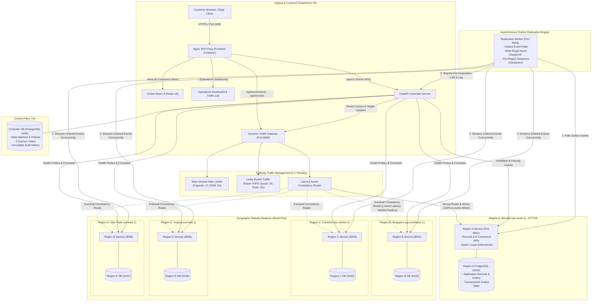
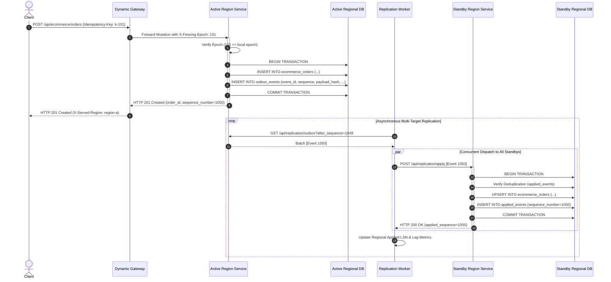
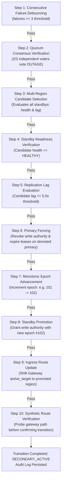

# FailoverLab: Five-Region Active-Passive Architecture & Live Traffic Laboratory
**System Design & SSD Case Study 23 — Academic Reference Architecture**

FailoverLab is an end-to-end, five-region active-passive control plane, multi-target replication engine, dynamic traffic gateway, and integrated e-commerce demonstration built with **Python 3.11+ / FastAPI**, **PostgreSQL 16**, **Docker & Docker Compose**, and a **React 19 + TypeScript + Vite** frontend.

It provides a production-grade educational platform demonstrating how modern cloud distributed architectures reliably detect regional outages, eliminate split-brain brain-damage via quorum majorities and fencing epochs, execute guarded 10-step failover with multi-region candidate selection, govern customer ingress with Token Bucket rate limiting and Leaky Bucket traffic shaping, route traffic based on consistency requirements and client geography, and safely coordinate guarded failback.

---

## Table of Contents
1. [Five-Region Active-Passive Architecture](#1-five-region-active-passive-architecture)
2. [Service Responsibilities](#2-service-responsibilities)
3. [Database & Replication Design](#3-database--replication-design)
4. [Eventual Consistency Model & Stale Read Policies](#4-eventual-consistency-model--stale-read-policies)
5. [Latency-Aware Routing Policy & Client Matrix](#5-latency-aware-routing-policy--client-matrix)
6. [Availability & 10-Step Failover Safety Architecture](#6-availability--10-step-failover-safety-architecture)
7. [Token Bucket Rate Limiting Algorithm](#7-token-bucket-rate-limiting-algorithm)
8. [Leaky Bucket Traffic Shaping Algorithm](#8-leaky-bucket-traffic-shaping-algorithm)
9. [Online Store Demonstration (`/shop`)](#9-online-store-demonstration-shop)
10. [Traffic Generation & Live Traffic Monitor](#10-traffic-generation--live-traffic-monitor)
11. [Failure & Chaos Simulation Controls](#11-failure--chaos-simulation-controls)
12. [Local Development Deployment](#12-local-development-deployment)
13. [Production Deployment & Hardening](#13-production-deployment--hardening)
14. [Known Simulation Limitations](#14-known-simulation-limitations)

---

## 1. Five-Region Active-Passive Architecture

The system models five logical geographic regions across four continents, orchestrated by a centralized active-passive control plane:

| Region ID | Location | Cloud Zone | Initial Role | Write Permission | Baseline Local WAN Delay |
| :--- | :--- | :--- | :--- | :--- | :--- |
| **`region-a`** | Mumbai, India | `ap-south-1` | **ACTIVE** | Authoritative Primary Writer | 18 ms |
| **`region-b`** | Singapore | `ap-southeast-1` | **STANDBY** | Read-Only Replica | 14 ms |
| **`region-c`** | Frankfurt, Germany | `eu-central-1` | **STANDBY** | Read-Only Replica | 16 ms |
| **`region-d`** | Virginia, USA | `us-east-1` | **STANDBY** | Read-Only Replica | 15 ms |
| **`region-e`** | São Paulo, Brazil | `sa-east-1` | **STANDBY** | Read-Only Replica | 20 ms |

### High-Level System Architecture Diagram



---

## 2. Service Responsibilities

| Service | Technology | Ports | Responsibilities |
| :--- | :--- | :--- | :--- |
| **`frontend`** | React 19, TypeScript, Vite, Tailwind CSS, Nginx | `3000:80` | Hosts the customer-facing Online Store at `/shop` and the operations dashboard at `/`. Features real-time topology visualizers, regional comparison matrix, live traffic streaming monitor, load generator, and simulation controls. |
| **`controller`** | Python 3.11+, FastAPI, SQLAlchemy 2 (async), Pydantic 2 | `8000:8000` | Authoritative brain of the system. Implements consecutive failure debouncing, 3-voter quorum consensus, candidate evaluation engine, monotonic fencing epoch issuance, gateway route orchestration, and Prometheus telemetry. |
| **`gateway`** | Python 3.11+, FastAPI, HTTPX, asyncio | `8080:8080` | Dynamic L7 ingress proxy. Implements Token Bucket rate limiting, Leaky Bucket traffic shaping, latency-aware routing, idempotency caching, synthetic route verification, and server-sent event (SSE) streaming. |
| **`region_service`** (5 instances) | Python 3.11+, FastAPI, asyncpg, PostgreSQL 16 | `8001`, `8002`, `8004`, `8005`, `8006` | Generalized regional data service. Enforces writer safety via fencing epochs; manages application records, product catalog, inventory stock, and orders. Atomically generates outbox events and tracks applied replication sequences. |
| **`replicator`** | Python 3.11+, FastAPI, HTTPX, asyncio | `8003:8003` | Multi-target asynchronous replication worker. Discovers the current active writer, polls ordered outbox batches, and replicates them concurrently to all 4 standbys. Tracks per-region applied sequences, pending bytes, and lag seconds. |
| **`controller-db`** | PostgreSQL 16 Alpine | `5434:5432` | Dedicated metadata and audit database. Stores controller state, safety policies, quorum voter registries, and append-only audit event logs. |
| **`region-*-db`** (5 databases) | PostgreSQL 16 Alpine | `5432`, `5433`, `5435`, `5436`, `5437` | Completely isolated relational databases for Mumbai, Singapore, Frankfurt, Virginia, and São Paulo. Dedicated named volumes ensure zero physical data sharing. |

---

## 3. Database & Replication Design

### 3.1 Physical Isolation & Independent Named Volumes
Every regional service connects to its own independent PostgreSQL 16 instance. No database files, tables, or Docker volumes are shared across regions:
- `controller_db_data` $\to$ `/var/lib/postgresql/data` (`failoverlab-controller-db`)
- `region_a_db_data` $\to$ `/var/lib/postgresql/data` (`failoverlab-region-a-db`)
- `region_b_db_data` $\to$ `/var/lib/postgresql/data` (`failoverlab-region-b-db`)
- `region_c_db_data` $\to$ `/var/lib/postgresql/data` (`failoverlab-region-c-db`)
- `region_d_db_data` $\to$ `/var/lib/postgresql/data` (`failoverlab-region-d-db`)
- `region_e_db_data` $\to$ `/var/lib/postgresql/data` (`failoverlab-region-e-db`)

### 3.2 Transactional Outbox Pattern
To prevent distributed dual-write inconsistencies between the database and the replication stream, the active writer utilizes the **Transactional Outbox Pattern**:
1. When a client performs a write (e.g. creating an order or updating a record), the application writes both the domain entity (`ecommerce_orders`) and an outbox entry (`outbox_events`) within the **same atomic database transaction**.
2. If the transaction commits, both records persist atomically. If the database crashes or aborts, neither persists.



### 3.3 Event Schema & Integrity Verification
Every outbox event carries cryptographic metadata to verify integrity and enforce total ordering:
- `event_id`: Unique UUID identifier.
- `source_region_id`: Region where the write occurred (e.g. `region-a`).
- `source_fencing_epoch`: Monotonic fencing epoch at the time of commit.
- `sequence_number`: Monotonically increasing 64-bit integer assigned by database sequence.
- `created_at`: UTC timestamp of the commit.
- `payload`: Structured JSON payload of the modified entity.
- `payload_hash`: SHA-256 cryptographic digest of the canonical payload JSON.

Each target standby maintains its own `applied_events` checkpoint table, ensuring that replays, retransmissions, or duplicate network packets are discarded idempotently.

---

## 4. Eventual Consistency Model & Stale Read Policies

The Gateway implements explicit request classification based on consistency requirements:

```
+--------------------------------------------------------------------------------+
| Customer Application Request                                                   |
+--------------------------------------------------------------------------------+
         |
         +---> GET /api/ecommerce/products (Product Catalog)
         |     Consistency: EVENTUAL READ
         |     Route to: Nearest healthy replica satisfying lag <= max_stale
         |
         +---> GET /api/ecommerce/inventory/* (Live Stock) OR /orders/* (Fulfillment)
         |     Consistency: STRONG READ
         |     Route to: 100% strictly to Current Active Primary Writer
         |
         +---> POST /api/ecommerce/orders (Place Order) OR DELETE (Cancel)
               Consistency: WRITE MUTATION
               Route to: 100% strictly to Current Active Primary Writer
```

### Staleness Policy (`max_stale_seconds`)
- For eventual reads, the Gateway evaluates candidate standby regions against `max_stale_seconds` (default: **5.0 seconds**).
- If a standby region's measured replication lag exceeds 5.0 seconds, it is marked **STALE** and disqualified from serving eventual reads.
- Customer traffic immediately fails over to the next lowest-latency healthy, fresh replica.
- Strong reads and writes ignore stale read replica routing and always route to the authoritative active writer.

---

## 5. Latency-Aware Routing Policy & Client Matrix

When an incoming eventual-consistency read arrives, the Gateway examines the client's geographic origin via the `X-Client-Region` header (or query parameter):

| Client Region ID | Client Origin | Nearest Target Region | Target Region Name | Estimated WAN Delay |
| :--- | :--- | :--- | :--- | :--- |
| **`ap-south-1`** | Mumbai / India | `region-a` | Mumbai, India | 18 ms |
| **`ap-southeast-1`** | Singapore / SE Asia | `region-b` | Singapore | 14 ms |
| **`eu-central-1`** | Frankfurt / Europe | `region-c` | Frankfurt, Germany | 16 ms |
| **`us-east-1`** | Virginia / North America | `region-d` | Virginia, USA | 15 ms |
| **`sa-east-1`** | São Paulo / South America | `region-e` | São Paulo, Brazil | 20 ms |

### Geographic Latency Matrix (Round-Trip WAN Delay in ms)
The Gateway maintains an interconnect latency model simulating real-world trans-oceanic network distances:

| From Client Region \ Target | region-a (Mumbai) | region-b (Singapore) | region-c (Frankfurt) | region-d (Virginia) | region-e (São Paulo) |
| :--- | :---: | :---: | :---: | :---: | :---: |
| **India (`ap-south-1`)** | **18 ms** | 72 ms | 110 ms | 190 ms | 310 ms |
| **Southeast Asia (`ap-southeast-1`)** | 72 ms | **14 ms** | 160 ms | 210 ms | 330 ms |
| **Europe (`eu-central-1`)** | 110 ms | 160 ms | **16 ms** | 88 ms | 195 ms |
| **North America (`us-east-1`)** | 190 ms | 210 ms | 88 ms | **15 ms** | 135 ms |
| **South America (`sa-east-1`)** | 310 ms | 330 ms | 195 ms | 135 ms | **20 ms** |

### Dynamic Replica Failover
If a client's nearest regional replica experiences an outage or becomes stale:
1. The Gateway filters the active replica pool for `health == HEALTHY` and `lag <= max_stale_seconds`.
2. It chooses the surviving region with the lowest WAN latency from the client's perspective according to the matrix above.
3. For example, if Frankfurt (`region-c`) fails, European clients automatically fail over to North America (`region-d`, 88 ms) or Mumbai (`region-a`, 110 ms).

---

## 6. Availability & 10-Step Failover Safety Architecture

To prevent split-brain disasters and guarantee that failover occurs safely without data loss, the Controller executes a deterministic **10-step safety workflow**:



### Safety Gates & Invariants
- **Quorum Consensus**: Requires at least 2 of 3 independent voter processes to declare primary outage before initiating failover.
- **Single Active Writer Invariant**: At any point in time, exactly ONE region accepts writes across the entire system.
- **Fencing Epochs**: Monotonically increasing tokens. If a partitioned or demoted primary attempts to accept a write, or if a request arrives with an obsolete epoch, it is rejected with **HTTP 403 Forbidden** or **HTTP 409 Conflict**.
- **Candidate Selection Engine (`target_region="auto"`)**:
  - Standbys with excessive replication lag (`lag > 5.0s`) are disqualified.
  - Standbys with health status `DOWN` or `DEGRADED` are disqualified.
  - The healthy candidate with the lowest replication lag and best proximity is selected.
  - Manual targeting (`target_region="region-c"`) remains supported for operational flexibility.
- **Guarded Failback**: Failback from secondary back to primary is never automatic; it requires human confirmation, healthy primary verification, and catch-up replication synchronization.

---

## 7. Token Bucket Rate Limiting Algorithm

The Gateway implements an exact Token Bucket rate limiter to protect regional services from traffic surges:

- **Bucket Capacity**: 10 tokens (maximum burst capacity).
- **Refill Rate**: 2 tokens per second (steady-state refill).
- **Request Cost**: 1 token per incoming request.

### Algorithm Behavior
1. Each incoming customer request checks the token bucket for the client's identifier.
2. Tokens refill continuously according to elapsed wall-clock time:
   $$\text{tokens} = \min\left(\text{capacity}, \text{current\_tokens} + \Delta t \times \text{refill\_rate}\right)$$
3. If $\text{tokens} \ge 1$, the request consumes 1 token and proceeds immediately.
4. If $\text{tokens} < 1$, the request is rejected immediately with **HTTP 429 Too Many Requests**.
5. Standard rate limiting response headers are attached:
   - `Retry-After`: Seconds until at least 1 token will be available.
   - `X-RateLimit-Limit`: Maximum token capacity.
   - `X-RateLimit-Remaining`: Tokens currently remaining.
   - `X-RateLimit-Reset`: Milliseconds until full bucket refill.
   - `X-RateLimit-Mode`: `TOKEN_BUCKET`.

---

## 8. Leaky Bucket Traffic Shaping Algorithm

The Gateway implements a true Leaky Bucket traffic shaper using a bounded FIFO queue and an asynchronous background leaky drain worker:

- **Queue Capacity**: 20 requests (maximum buffer size).
- **Drain Rate**: 2 requests per second (constant output pace).
- **Behavior**:
  - Arriving requests enter a FIFO queue.
  - The leaky drain process releases requests at the configured constant leak rate, smoothing sharp bursts into a steady, predictable stream.
  - Queued requests wait for their turn; their queue wait time is tracked and injected into `X-Queue-Wait-Time-Ms`.
  - If the queue exceeds capacity (20 requests), excess requests are rejected with **HTTP 429 Too Many Requests** (`Leaky bucket queue overflow`).

---

## 9. Online Store Demonstration (`/shop`)

The integrated Online Store is accessible at `/shop` on the frontend. It provides a realistic customer shopping experience designed to demonstrate FailoverLab's routing and fault tolerance in action:

1. **Client Region Selector**: A top banner allows users to switch their simulated geographic location (India, Singapore, Europe, North America, South America).
2. **Product Catalog**: Shows hardware appliances, laptops, and networking products. Requests use eventual-consistency reads routed to the nearest regional replica.
3. **Gateway Metadata Banner**: Each page displays live Gateway diagnostic metadata:
   - Served Region (e.g. `region-a [Mumbai, India]`).
   - Active Region.
   - Consistency Level (`eventual`, `strong`, or `write`).
   - Simulated WAN Delay (e.g. `18.0 ms`).
   - Gateway Internal Processing Latency.
   - Rate Limiter Status and remaining tokens.
4. **Live Stock Verification**: Opening a product details modal triggers a strong-consistency read directly to the active writer to verify authoritative inventory.
5. **Cart & Checkout**: Adding items calculates real-time subtotal, shipping, and tax. Submitting an order sends a `POST /api/ecommerce/orders` mutation with an `Idempotency-Key` header, routing strictly to the active writer and generating a transactional outbox event.
6. **Order Confirmation**: Displays the confirmed order ID, assigned sequence number, outbox event ID, and the region that committed the order.

---

## 10. Traffic Generation & Live Traffic Monitor

The **Traffic Lab** view on the operations dashboard (`/`) enables live interactive traffic experiments:

### 10.1 Load Generator
- **Traffic Profiles**:
  - *Balanced E-Commerce*: 60% Catalog Eventual Reads, 25% Stock Strong Reads, 15% Order Writes.
  - *Catalog Browsing Surge*: 95% Eventual Reads, 5% Writes.
  - *High-Volume Checkout*: 70% Order Writes, 30% Strong Reads.
- **Controls**: Configurable RPS (1 to 50 requests/sec), concurrency (1 to 10 workers), and test duration.

### 10.2 Live Traffic Monitor
- Streams real-time Gateway traffic events via Server-Sent Events (SSE) from `/api/v1/traffic/events`.
- Displays request ID, timestamp, method, endpoint, client region, served region, consistency level, status code, latency, and rate limiter decision (`accepted`, `delayed`, `throttled`).
- Live charts track Request Throughput (RPS), Regional Traffic Distribution (pie chart), and Error / Rejection Rates.

---

## 11. Failure & Chaos Simulation Controls

The **Simulation Controls Panel** in the Traffic Lab allows operators to inject real-time chaos to observe failover and traffic shaper behaviors:

1. **Regional Outage Injection**: Click any region's status button to transition its health between `HEALTHY` and `DOWN`.
2. **Replication Lag Spikes**: Use the slider or preset buttons to spike replication lag on any standby region (e.g. spiking Singapore to 8.5s to trigger candidate disqualification).
3. **Replication Pause / Resume**: Temporarily freeze outbox event delivery to a specific region to observe growing sequence drift and pending byte accumulation.
4. **Rate Limiter Mode Toggle**: Switch Gateway traffic control between `OFF`, `TOKEN_BUCKET`, and `LEAKY_BUCKET` in real time without restarting services.
5. **WAN Latency Simulation**: Adjust base WAN latencies to test degraded network links.

---

## 12. Local Development Deployment

### Prerequisites
- Docker Engine 24.0+ & Docker Compose v2.20+
- 8 GB RAM recommended (minimum 4 GB RAM available)
- Ports available: `3000` (Frontend), `8000` (Controller), `8080` (Gateway), `8001-8006` (Regional Services & Replicator), `5432-5437` (PostgreSQL databases)

### Quick Start
```bash
# 1. Clone repository
git clone https://github.com/darshankankekar-dev/FailoverLab-SSD-CaseStudy23.git
cd FailoverLab-SSD-CaseStudy23

# 2. Start all 15 services with Docker Compose
docker compose up --build -d

# 3. Verify health status of all containers
docker compose ps

# 4. Open applications in your web browser:
# - Operations Dashboard:  http://localhost:3000/
# - Online Store:          http://localhost:3000/shop
# - Controller OpenAPI:    http://localhost:8000/docs
# - Gateway Telemetry:     http://localhost:8080/metrics
```

### Running Automated Test Suites Locally
```bash
# Gateway Tests (37 tests)
pytest --import-mode=importlib gateway/tests/

# Controller Tests (55 tests)
pytest --import-mode=importlib controller/tests/

# Replication Worker Tests (14 tests)
pytest --import-mode=importlib replication_worker/tests/

# Regional Service Tests (18 tests)
pytest --import-mode=importlib region_service/tests/

# Frontend Vitest Suite (65 tests)
npm --prefix "FailoverLab - Frontend" test -- --run

# Frontend Production Build Check
npm --prefix "FailoverLab - Frontend" run build
```

---

## 13. Production Deployment & Hardening

The production deployment (`compose.prod.yaml`) implements strict security and operational hardening:

1. **Host Port Concealment**:
   - Only the frontend container binds to the host, strictly on loopback: `127.0.0.1:${FRONTEND_PORT:-3000}:80`.
   - Databases (`5432-5437`), regional microservices (`8001-8006`), controller (`8000`), gateway (`8080`), and replicator (`8003`) publish **zero host ports**.
   - All inter-service communication occurs over the isolated Docker bridge network `failover_network`.
2. **Mandatory Cryptographic Secrets**:
   - `compose.prod.yaml` requires non-empty `POSTGRES_PASSWORD` and `INTERNAL_API_SECRET`. Startup aborts if defaults are detected.
3. **Admin API Authentication**:
   - When `REQUIRE_ADMIN_AUTH=true`, mutating endpoints (`/api/v1/failover`, `/api/v1/failback`, `/internal/chaos/*`) require the `X-Admin-Secret` header.
   - Public calls without valid secrets receive **HTTP 403 Forbidden**.
4. **Restricted Documentation in Production**:
   - The Nginx reverse proxy restricts `/docs`, `/openapi.json`, and `/redoc` unless authenticated with `X-Admin-Secret`.
5. **Caddy Reverse Proxy & Automated TLS**:
   - Host Caddy reverse proxy terminates HTTPS, enables zstd/gzip compression, and enforces security headers (`HSTS`, `X-Frame-Options: DENY`, `X-Content-Type-Options: nosniff`).
6. **Resource Limits & Reservations**:
   - All 15 containers enforce strict resource ceilings in Docker Compose:
     - 6 Databases: Limit 512MB RAM, 0.5 CPU; Reservation 128MB RAM, 0.1 CPU.
     - 8 Python Microservices: Limit 384MB RAM, 0.5 CPU; Reservation 128MB RAM, 0.1 CPU.
     - 1 Frontend: Limit 256MB RAM, 0.5 CPU; Reservation 64MB RAM, 0.1 CPU.
     - Baseline footprint: ~1.85 GB RAM; Maximum ceiling: ~6.3 GB RAM.

### Production Startup Command
```bash
# 1. Prepare production configuration
cp .env.production.example .env.production

# 2. Populate secrets in .env.production:
# POSTGRES_PASSWORD=$(openssl rand -base64 24)
# INTERNAL_API_SECRET=$(openssl rand -hex 32)

# 3. Start production stack
docker compose -f compose.prod.yaml up -d --build
```

---

## 14. Known Simulation Limitations

This project is an **academic prototype and distributed systems simulation**. The following engineering constraints must be understood:

1. **Single-Host Physical Co-location**:
   - All five logical regions run inside isolated Docker containers on a single virtual machine host.
   - Physical host outages, hypervisor reboots, or host network disconnections will affect all regions simultaneously.
2. **Synthetic WAN Latency**:
   - Regional network latency differences (e.g. 18ms Mumbai vs. 310ms São Paulo) are simulated in software at the Gateway and client layers. They do not traverse physical intercontinental subsea fiber cables.
3. **Application-Level Outbox Replication**:
   - Asynchronous replication is driven by the application-level Transactional Outbox Pattern rather than native database storage replication (such as Aurora Global Database storage replication or physical PostgreSQL WAL streaming).
4. **No Replacement for Geo-Distributed Production Infrastructure**:
   - Running five logical containers on one VM does not provide geographic disaster resilience against real-world datacenter failures, power grid losses, or fiber cuts. Production multi-region deployments require physically distributed nodes across separate cloud availability zones and regions.
