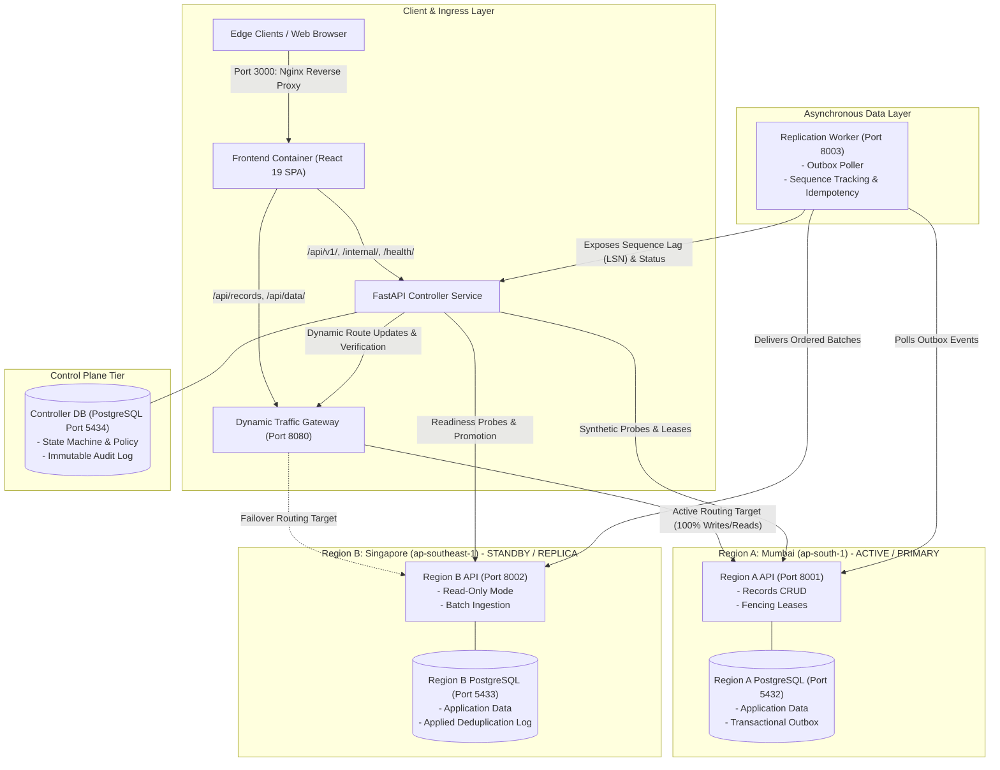
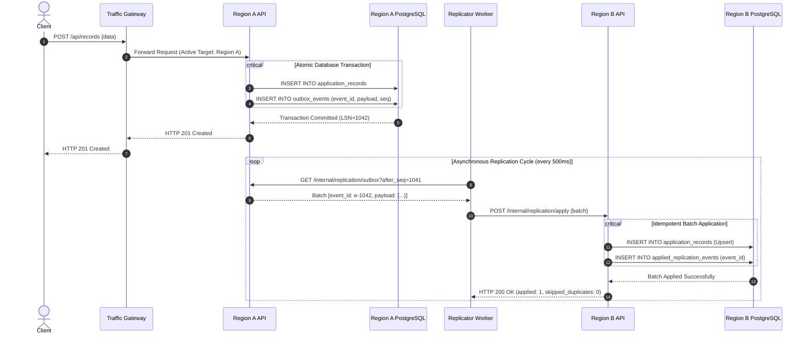
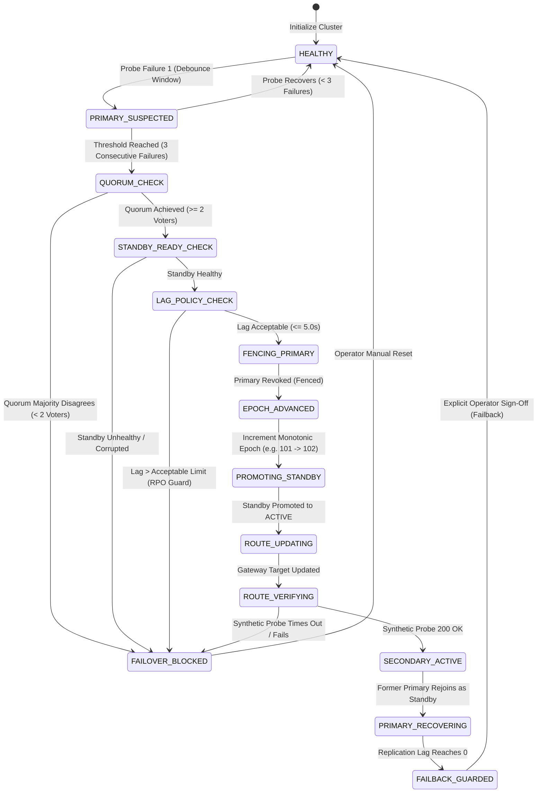

# FailoverLab: Multi-Region Active-Passive Failover Controller
**System Design & SSD Case Study 23 — Academic Prototype & Full-Stack Reference Architecture**

FailoverLab is an end-to-end, multi-region active-passive control plane implementation and interactive demonstration built with **Python 3.11+ / FastAPI**, **PostgreSQL 16**, **Docker & Docker Compose**, and a **React 19 + TypeScript + Vite** frontend.

It provides a production-grade educational architecture demonstrating how distributed systems reliably detect outages, prevent split-brain brain-damage via fencing epochs and quorum majority consensus, execute guarded failover across 10 deterministic decision steps, verify dynamic routing before traffic cutover, and safely orchestrate human-guarded failback.

---

## 1. System Architecture



---

## 2. Service Responsibilities

| Service | Technology | Ports | Key Responsibilities |
| :--- | :--- | :--- | :--- |
| **`frontend`** | React 19, TypeScript, Vite, Tailwind CSS, Nginx | `3000:80` | Interactive topology visualizer, scenario runner, audit timeline, live state polling, and educational reports. |
| **`controller`** | Python 3.11, FastAPI, SQLAlchemy 2 (async), Pydantic 2 | `8000:8000` | Authoritative state machine, consecutive health check debouncing, quorum consensus evaluation, fencing epoch issuance, gateway route orchestration, and Prometheus telemetry. |
| **`gateway`** | Python 3.11, FastAPI, HTTPX, asyncio | `8080:8080` | Dynamic L7 ingress proxy, in-memory route caching with TTL, zero-downtime routing cutover, synthetic route verification probe handler, and request latency instrumentation. |
| **`region-a`** | Python 3.11, FastAPI, asyncpg, PostgreSQL | `8001:8001` | Primary data service for Mumbai (`ap-south-1`). Accepts write requests under current fencing epoch; commits entity data and transactional outbox events atomically. |
| **`region-b`** | Python 3.11, FastAPI, asyncpg, PostgreSQL | `8002:8002` | Standby data service for Singapore (`ap-southeast-1`). Rejects external writes; ingests idempotent replication batches; promotes to active writer upon controller instruction. |
| **`replicator`** | Python 3.11, FastAPI, HTTPX | `8003:8003` | Asynchronous outbox worker. Polls ordered outbox batches from primary, streams to secondary, verifies deduplication, tracks sequence lag (LSN equivalent), and exposes lag metrics. |
| **`controller-db`** | PostgreSQL 16 Alpine | `5434:5432` | Persistent storage for controller state, active policies, quorum voters, and append-only audit event history. |
| **`region-a-db`** | PostgreSQL 16 Alpine | `5432:5432` | Isolated relational database for Region A. Contains application records, outbox queue, and local metadata. |
| **`region-b-db`** | PostgreSQL 16 Alpine | `5433:5432` | Isolated relational database for Region B. Zero physical data sharing with Region A. |

---

## 3. Database & Replication Design

### 3.1 Physical Isolation & Separate Named Volumes
The three PostgreSQL databases run in independent Docker containers with distinct persistent storage volumes:
- `controller_db_data` $\to$ `/var/lib/postgresql/data` (`failoverlab-controller-db`)
- `region_a_db_data` $\to$ `/var/lib/postgresql/data` (`failoverlab-region-a-db`)
- `region_b_db_data` $\to$ `/var/lib/postgresql/data` (`failoverlab-region-b-db`)

No data files or tables are shared across regions. This guarantees that a corrupted disk or dead instance in Region A does not impact Region B.

### 3.2 Transactional Outbox Pattern vs. Physical WAL Streaming
> [!NOTE]
> **Why Application-Level Outbox Replication is Used**:
> In enterprise cloud environments, cross-region replication is frequently implemented using native database replication (such as PostgreSQL physical WAL streaming, AWS Aurora Global Database storage replication, or Google Cloud Spanner Paxos groups).
> 
> In this academic prototype, we implement an **application-level Transactional Outbox Pattern**. This architectural choice provides:
> 1. **Complete Visibility**: Every replicated change is a discrete, inspectable JSON payload with sequence numbers, timestamps, and payload hashes.
> 2. **Injectable Chaos**: Allows intentional, deterministic simulation of WAN packet loss, bandwidth throttling, replication lag spikes, and network partitions without requiring OS-level network disruption.
> 3. **Controlled Direction Reversal**: Demonstrates how an application worker inspects the controller's active fencing epoch, halts outbox pulling from a demoted primary, and begins pulling from the newly promoted primary during failback.

### 3.3 Atomic Outbox Commit & Idempotency


---

## 4. Controller State Machine & Decision Workflow

### 4.1 State Machine Lifecycle


### 4.2 The 10-Step Deterministic Failover Decision Protocol
FailoverLab enforces 10 strict sequential safety gates. If any step fails, the transition is halted immediately with status `BLOCKED` and the root cause is logged to the immutable audit trail:

1. **Step 1: Evaluate Health Checks**: Requires 3 consecutive failed probes against Region A to suppress transient network blips and false positives.
2. **Step 2: Quorum Majority Consensus**: Queries 3 independent observers (`Mumbai Local`, `Singapore Local`, `Zurich Independent Tie-Breaker`). Requires a majority ($\ge 2$) confirming primary outage before permitting action.
3. **Step 3: Standby Readiness Verification**: Validates Region B health status and rejects failover if the secondary storage is corrupted or unready.
4. **Step 4: Replication Lag Policy (RPO Protection)**: Compares current replication lag against policy threshold ($< 5.0\text{s}$). If lag exceeds the threshold, failover is blocked to protect against unacceptable data loss.
5. **Step 5: Fencing Former Primary**: Dispatches a fencing command to Region A (`POST /admin/fence`). Revokes write leases (`accepts_writes: false`, `is_fenced: true`) to guarantee the old primary cannot accept stale writes.
6. **Step 6: Monotonic Epoch Advancement**: Increments the cluster-wide fencing generation number (`epoch = current + 1`). Any incoming requests carrying older epochs are rejected with `HTTP 409 Conflict`.
7. **Step 7: Standby Promotion**: Grants write authority to Region B (`POST /admin/promote`) with the new fencing epoch.
8. **Step 8: Dynamic Gateway Route Update**: Instructs the traffic gateway (`PUT /internal/routing/target`) to shift all ingress traffic to Region B.
9. **Step 9: Synthetic Route Verification**: Dispatches an end-to-end synthetic probe through the gateway. Failover is never considered complete until this probe succeeds.
10. **Step 10: Commit Failover & Audit**: Advances controller state to `SECONDARY_ACTIVE` and appends an immutable audit event recording wall-clock recovery duration.

---

## 5. Observability & Truthful Telemetry Architecture

### 5.1 Contextual Structured Logging
All backend services (`controller`, `gateway`, `region-a`, `region-b`, `replicator`) emit structured JSON/console logs enriched with distributed tracing context variables:

| Context Key | Description | Example |
| :--- | :--- | :--- |
| `req` | Unique HTTP request correlation ID propagated across service boundaries via `X-Correlation-ID` | `req-9014bd5379` |
| `tx` | Unique transition identifier tracking a multi-step failover or failback lifecycle | `tx-d032ea3b10a1` |
| `region` | Target or executing region identity | `region-b` |
| `epoch` | Active monotonic fencing generation number | `102` |

#### Controller Structured Log Trace Example
```log
2026-11-05T15:57:06.240Z [INFO] [req=req-9014bd5379, tx=tx-d032ea3b10a1, region=region-b, epoch=101] controller.services.failover: [FAILOVER_START] Initiated transition tx-d032ea3b10a1 towards 'region-b' [Epoch #101]
2026-11-05T15:57:06.243Z [INFO] [req=req-9014bd5379, tx=tx-d032ea3b10a1, region=region-b, epoch=101] controller.services.failover: [QUORUM_CONSENSUS] Step 2 quorum verified: Quorum consensus achieved: 3 of 3 independent voters confirmed primary outage (required: 2).
2026-11-05T15:57:06.244Z [INFO] [req=req-9014bd5379, tx=tx-d032ea3b10a1, region=region-b, epoch=101] controller.services.failover: [STANDBY_READY] Step 3 standby readiness confirmed: Region B is HEALTHY
2026-11-05T15:57:06.244Z [INFO] [req=req-9014bd5379, tx=tx-d032ea3b10a1, region=region-b, epoch=101] controller.services.failover: [REPLICATION_LAG_OK] Step 4 lag verified (0.8s <= 5.0s)
2026-11-05T15:57:06.244Z [INFO] [req=req-9014bd5379, tx=tx-d032ea3b10a1, region=region-b, epoch=101] controller.services.failover: [FENCING_PRIMARY] Revoking write authority on Region A [Epoch #101]
2026-11-05T15:57:06.677Z [INFO] [req=req-9014bd5379, tx=tx-d032ea3b10a1, region=region-b, epoch=101] httpx: HTTP Request: POST http://region-a:8001/admin/fence "HTTP/1.1 200 OK"
2026-11-05T15:57:06.684Z [INFO] [req=req-9014bd5379, tx=tx-d032ea3b10a1, region=region-b, epoch=102] controller.services.failover: [EPOCH_ADVANCED] Monotonic fencing epoch advanced from #101 to #102
2026-11-05T15:57:06.684Z [INFO] [req=req-9014bd5379, tx=tx-d032ea3b10a1, region=region-b, epoch=102] controller.services.failover: [PROMOTING_STANDBY] Granting write authority to Region B with epoch #102
2026-11-05T15:57:07.122Z [INFO] [req=req-9014bd5379, tx=tx-d032ea3b10a1, region=region-b, epoch=102] httpx: HTTP Request: POST http://region-b:8002/admin/promote "HTTP/1.1 200 OK"
2026-11-05T15:57:07.123Z [INFO] [req=req-9014bd5379, tx=tx-d032ea3b10a1, region=region-b, epoch=102] controller.services.failover: [ROUTE_UPDATING] Pointing ingress gateway target to Region B (TTL=2.0s)
2026-11-05T15:57:07.387Z [INFO] [req=req-9014bd5379, tx=tx-d032ea3b10a1, region=region-b, epoch=102] httpx: HTTP Request: PUT http://gateway:8080/internal/routing/target "HTTP/1.1 200 OK"
2026-11-05T15:57:07.389Z [INFO] [req=req-9014bd5379, tx=tx-d032ea3b10a1, region=region-b, epoch=102] controller.services.failover: [VERIFYING_ROUTE] Dispatching synthetic test probe to verify route reachability
2026-11-05T15:57:07.586Z [INFO] [req=req-9014bd5379, tx=tx-d032ea3b10a1, region=region-b, epoch=102] httpx: HTTP Request: GET http://gateway:8080/internal/routing/probe "HTTP/1.1 200 OK"
2026-11-05T15:57:07.588Z [INFO] [req=req-9014bd5379, tx=tx-d032ea3b10a1, region=region-b, epoch=102] controller.services.failover: [ROUTE_PROBE_RESULT] Probe verified=True, latency_ms=157.62
2026-11-05T15:57:07.588Z [INFO] [req=req-9014bd5379, tx=tx-d032ea3b10a1, region=region-b, epoch=102] controller.services.failover: [FAILOVER_COMPLETED] Transition tx-d032ea3b10a1 complete across all 10 decision steps. Region B active primary [Epoch #102].
```

### 5.2 Truthful Metrics vs Modeled Metrics
FailoverLab strictly separates **empirically measured lab metrics** from **educational UI simulation models**:

```json
{
  "truthful_metrics": {
    "failover_attempts_total": 3,
    "failover_successes_total": 1,
    "failover_blocked_total": 2,
    "failover_blocked_by_gate": {
      "Gate 1: Consecutive Failure Threshold": 1,
      "Gate 2: Quorum Majority Consensus": 1
    },
    "route_update_attempts_total": 1,
    "route_update_successes_total": 1,
    "route_update_errors_total": 0,
    "healthy_regions_count": 1,
    "last_lab_recovery_seconds": 40.01,
    "is_simulated_lab_metric": true,
    "metric_caveat": "Measured wall-clock duration in simulated lab test environment. Does not represent production enterprise RTO."
  }
}
```

- **Truthful Counters**: Real-time monotonic counters tracking every transition attempt, successful failover, blocked outcome broken down by specific gate, and gateway route update latencies.
- **`last_lab_recovery_seconds`**: Wall-clock duration elapsed between the timestamp when consecutive probe failures confirmed an outage and the exact moment route verification succeeded.
- **Accurate Labeling**: Modeled client requests per second ($2,450\text{ RPS}$) and synthetic packet loss percentages are clearly labeled as `mode="simulated"` in telemetry to ensure academic honesty.

### 5.3 Prometheus Plaintext Exposition (`/metrics`)
Both the `controller` and `gateway` expose standard Prometheus plaintext endpoints conforming to the OpenMetrics specification (`text/plain; version=0.0.4`):

#### Controller (`http://localhost:8000/metrics`)
```prometheus
# HELP failoverlab_healthy_regions Number of regions currently reporting healthy status
# TYPE failoverlab_healthy_regions gauge
failoverlab_healthy_regions 1

# HELP failoverlab_consecutive_failed_health_checks Consecutive failed health check probes against primary
# TYPE failoverlab_consecutive_failed_health_checks gauge
failoverlab_consecutive_failed_health_checks 3

# HELP failoverlab_active_region Binary indicator of currently active primary region
# TYPE failoverlab_active_region gauge
failoverlab_active_region{region="region-a"} 0
failoverlab_active_region{region="region-b"} 1

# HELP failoverlab_fencing_epoch Authoritative monotonic fencing epoch generation
# TYPE failoverlab_fencing_epoch gauge
failoverlab_fencing_epoch 102

# HELP failoverlab_replication_lag_seconds Measured replication lag in seconds
# TYPE failoverlab_replication_lag_seconds gauge
failoverlab_replication_lag_seconds 0.8

# HELP failoverlab_failover_transitions_total Total failover attempts by outcome
# TYPE failoverlab_failover_transitions_total counter
failoverlab_failover_transitions_total{outcome="attempt"} 3
failoverlab_failover_transitions_total{outcome="success"} 1
failoverlab_failover_transitions_total{outcome="blocked"} 2

# HELP failoverlab_lab_recovery_seconds Wall-clock duration from confirmed outage detection to verified recovery in lab test
# TYPE failoverlab_lab_recovery_seconds gauge
failoverlab_lab_recovery_seconds{environment="simulated_lab"} 40.01
```

#### Gateway (`http://localhost:8080/metrics`)
```prometheus
# HELP failoverlab_gateway_requests_total Total HTTP requests handled by the ingress gateway
# TYPE failoverlab_gateway_requests_total counter
failoverlab_gateway_requests_total 207

# HELP failoverlab_gateway_client_errors_total Total 4xx responses emitted by gateway
# TYPE failoverlab_gateway_client_errors_total counter
failoverlab_gateway_client_errors_total 0

# HELP failoverlab_gateway_server_errors_total Total 5xx responses emitted by gateway
# TYPE failoverlab_gateway_server_errors_total counter
failoverlab_gateway_server_errors_total 0

# HELP failoverlab_gateway_latency_p95_ms Measured P95 request latency in milliseconds
# TYPE failoverlab_gateway_latency_p95_ms gauge
failoverlab_gateway_latency_p95_ms 0.61

# HELP failoverlab_gateway_active_route Current active target region in gateway table
# TYPE failoverlab_gateway_active_route gauge
failoverlab_gateway_active_route{target="region-a"} 0
failoverlab_gateway_active_route{target="region-b"} 1
```

---

## 6. Complete API Reference

### 6.1 Controller Service (`http://localhost:8000`)
| Method | Endpoint | Description |
| :--- | :--- | :--- |
| `GET` | `/health/live` | Liveness probe verifying controller process uptime. |
| `GET` | `/health/ready` | Readiness probe verifying PostgreSQL database connectivity. |
| `GET` | `/api/v1/state` | Returns the complete system state, regions, policy, replication, route, and voters. |
| `GET` | `/api/v1/regions` | Returns metadata, health, and fencing roles for Region A and Region B. |
| `GET` | `/api/v1/policy` | Returns active failover policy thresholds and timings. |
| `PUT` | `/api/v1/policy` | Updates failover thresholds (consecutive failures, lag tolerance, quorum majority). |
| `GET` | `/api/v1/events` | Retrieves paginated append-only audit trail events. |
| `GET` | `/api/v1/metrics` | Returns live truthful metrics alongside modeled telemetry. |
| `POST` | `/api/v1/failover` | Triggers the 10-step failover workflow towards the specified target region. |
| `POST` | `/api/v1/failback` | Triggers the guarded failback workflow towards the recovered primary. |
| `POST` | `/api/v1/reset` | Resets all regions, epochs, routes, and voter telemetry to baseline healthy state. |
| `GET` | `/metrics` | Standard Prometheus plaintext metrics endpoint. |
| `POST` | `/internal/chaos/primary-outage` | Injects synthetic primary crash in Mumbai (Region A). |
| `POST` | `/internal/chaos/recover-primary` | Injects synthetic primary recovery (rejoining as standby). |
| `POST` | `/internal/chaos/partition` | Injects cross-region WAN network partition and voter split. |
| `POST` | `/internal/chaos/replication-lag` | Injects synthetic replication lag spike (`?lag_seconds=8.4`). |
| `POST` | `/internal/chaos/standby-unready` | Corrupts Region B storage readiness. |
| `POST` | `/internal/chaos/route-failure` | Injects synthetic gateway routing verification failure. |
| `POST` | `/internal/telemetry/tick` | Advances simulated time clock and executes health monitor evaluation. |

### 6.2 Traffic Gateway Service (`http://localhost:8080`)
| Method | Endpoint | Description |
| :--- | :--- | :--- |
| `GET` | `/health` | Ingress gateway liveness and upstream reachability health check. |
| `GET` | `/api/records` | Forwards read request to the currently active primary region. |
| `POST` | `/api/records` | Forwards write request to the currently active primary region. |
| `PUT` | `/internal/routing/target` | Protected route update endpoint called by controller during failover. |
| `GET` | `/internal/routing/probe` | Synthetic route verification endpoint dispatching real traffic to active region. |
| `GET` | `/api/v1/metrics` | JSON gateway telemetry (requests total, error rates, P50/P95/P99 latency). |
| `GET` | `/metrics` | Standard Prometheus plaintext metrics endpoint for gateway ingress. |

### 6.3 Regional API Services (`http://localhost:8001` & `http://localhost:8002`)
| Method | Endpoint | Description |
| :--- | :--- | :--- |
| `GET` | `/health` | Regional API and local PostgreSQL database health probe. |
| `GET` | `/api/records` | Reads application records from the regional database. |
| `POST` | `/api/records` | Creates application record and inserts transactional outbox event. Rejected if standby or fenced. |
| `GET` | `/api/status` | Returns regional role, health, IOPS, and accepted fencing epoch. |
| `GET` | `/internal/replication/outbox` | Protected endpoint returning ordered outbox batches for the replication worker. |
| `POST` | `/internal/replication/apply` | Protected endpoint ingesting replication batches with idempotent deduplication. |
| `POST` | `/admin/fence` | Revokes write authorization and marks regional service hard-fenced. |
| `POST` | `/admin/promote` | Advances accepted fencing epoch and promotes regional service to active writer. |

### 6.4 Replication Worker Service (`http://localhost:8003`)
| Method | Endpoint | Description |
| :--- | :--- | :--- |
| `GET` | `/health` | Worker liveness probe. |
| `GET` | `/status` | Returns replication status, current source/target, and measured sequence lag. |
| `POST` | `/replicate` | Triggers an immediate replication cycle between active primary and standby. |

---

## 7. Hands-on Failure Demonstrations

### Demo 1: Quorum Protection Against Split-Brain (False Positive Suppression)
Attempting failover without an outage or without quorum majority is immediately blocked at Step 2:

```bash
# 1. Reset cluster to clean state
curl -s -X POST http://localhost:8000/api/v1/reset -H "Content-Type: application/json" -d "{}"

# 2. Attempt forced failover while observers report PRIMARY_HEALTHY
curl -s -X POST http://localhost:8000/api/v1/failover -H "Content-Type: application/json" \
  -d '{"reason": "Unauthorized manual attempt", "target_region": "region-b", "force": true}'
```
**Expected Output:**
```json
{
  "status": "BLOCKED",
  "previous_state": "QUORUM_CHECK",
  "current_state": "FAILOVER_BLOCKED",
  "fencing_epoch": 101,
  "message": "Failover blocked at Step 2 (Insufficient Quorum Majority).",
  "blocked_reason": "Insufficient quorum consensus: Only 0 of 3 voters confirmed outage (required: 2). Transition blocked to prevent false partition failover."
}
```

---

### Demo 2: Debounce Filter Suppressing Transient Network Jitter
Simulate a single failed probe that recovers before reaching the 3-failure threshold:

```bash
# 1. Inject primary failure
curl -s -X POST http://localhost:8000/internal/chaos/primary-outage

# 2. Advance clock by 1 tick (1 failure out of 3)
curl -s -X POST http://localhost:8000/internal/telemetry/tick

# 3. Recover primary before threshold
curl -s -X POST http://localhost:8000/internal/chaos/recover-primary
curl -s -X POST http://localhost:8000/internal/telemetry/tick

# 4. Check audit log
curl -s http://localhost:8000/api/v1/events | grep "False Positive Suppressed"
```
**Observed Result**: Controller state transitions `PRIMARY_SUSPECTED -> HEALTHY` without ever triggering failover or touching gateway routes.

---

### Demo 3: End-to-End Automatic Failover Execution
Simulate a confirmed primary crash with quorum consensus and verify full 10-step execution:

```bash
# 1. Inject primary outage
curl -s -X POST http://localhost:8000/internal/chaos/primary-outage

# 2. Advance 3 ticks to satisfy debounce threshold and trigger quorum consensus
curl -s -X POST http://localhost:8000/internal/telemetry/tick
curl -s -X POST http://localhost:8000/internal/telemetry/tick
curl -s -X POST http://localhost:8000/internal/telemetry/tick

# 3. Execute failover transition
curl -s -X POST http://localhost:8000/api/v1/failover -H "Content-Type: application/json" \
  -d '{"reason": "Confirmed primary outage", "target_region": "region-b", "force": false}'
```
**Observed Result**: All 10 gates pass. Monotonic epoch increments to `102`. Region B is promoted. Gateway target shifts to `region-b`. Synthetic probe confirms 200 OK. Controller state becomes `SECONDARY_ACTIVE`.

---

### Demo 4: RPO Lag Guard Blocking Failover
Enforce data loss prevention by blocking failover when replication lag exceeds the configured threshold:

```bash
# 1. Reset cluster
curl -s -X POST http://localhost:8000/api/v1/reset -H "Content-Type: application/json" -d "{}"

# 2. Inject replication lag spike (8.4 seconds > 5.0 seconds threshold)
curl -s -X POST "http://localhost:8000/internal/chaos/replication-lag?lag_seconds=8.4"

# 3. Inject primary outage & ticks
curl -s -X POST http://localhost:8000/internal/chaos/primary-outage
curl -s -X POST http://localhost:8000/internal/telemetry/tick
curl -s -X POST http://localhost:8000/internal/telemetry/tick
curl -s -X POST http://localhost:8000/internal/telemetry/tick

# 4. Attempt failover
curl -s -X POST http://localhost:8000/api/v1/failover -H "Content-Type: application/json" \
  -d '{"reason": "Attempting failover under heavy lag", "target_region": "region-b", "force": false}'
```
**Expected Output:**
```json
{
  "status": "BLOCKED",
  "current_state": "FAILOVER_BLOCKED",
  "message": "Failover blocked at Step 4 (Replication Lag Exceeded Policy).",
  "blocked_reason": "Replication lag (8.4s) exceeds acceptable threshold (5.0s). Promotion blocked to protect RPO against catastrophic data loss."
}
```

---

## 8. Automated Testing & Quality Verification

### 8.1 In-Container Test Execution
Run the full backend test suite inside Docker without requiring any local Python installation:
```bash
docker compose --profile test run --rm test-runner
```
**Test Results (60 passed in 3.25s):**
- `controller/tests/`: 32 passed (safety gates, state machine, quorum evaluation, fencing, failback)
- `region_service/tests/`: 9 passed (records CRUD, outbox generation, writer safety, epoch checks)
- `replication_worker/tests/`: 9 passed (batch delivery, deduplication idempotency, lag measurement)
- `gateway/tests/`: 10 passed (dynamic routing, route caching, TTL expiration, synthetic probes)

### 8.2 Frontend Production Build & Unit Tests
Verify the React 19 production build and test suite:
```bash
# Run 55 Vitest unit tests
npm --prefix "FailoverLab - Frontend" test -- --run

# Compile production assets (TypeScript & Vite)
npm --prefix "FailoverLab - Frontend" run build
```
**Test Results:**
- 4 test files passed, 55 tests passed in 1.15s.
- `dist/` built successfully with zero TypeScript or Vite errors in 2.61s.

---

## 9. Known Limitations & Academic Prototype Disclaimers

> [!CAUTION]
> **Academic Prototype Notice & Production Distinctions**:
> 1. **Educational Simulation**: FailoverLab is an educational case study designed for systems engineering students, architects, and practitioners. It is **not** an off-the-shelf production disaster recovery framework.
> 2. **Simulated Lab RTO**: The metric `failoverlab_lab_recovery_seconds` reflects the wall-clock execution time of this containerized local test harness. It does **not** prove or guarantee Recovery Time Objectives (RTO) or Recovery Point Objectives (RPO) in production multi-cloud deployments.
> 3. **Application Outbox vs. Physical WAL Streaming**: As detailed in Section 3.2, replication is handled via an application-level transactional outbox worker for observability and chaos demonstration. Production high-throughput RDBMS architectures typically rely on kernel-level physical streaming or hardware-assisted distributed consensus.
> 4. **Single Host Demonstration**: By default, all 9 containers run under a single Docker daemon on one physical host. In a genuine multi-region production deployment, Region A, Region B, and the Control Plane must reside in distinct physical cloud regions or cloud providers with physically independent power, networking, and DNS anycast edge infrastructure.

---

## 10. Future Scope & Roadmap

- [ ] **Raft/Paxos Consensus Integration**: Replace simulated observer voters with a distributed Raft consensus cluster (e.g. `etcd` or `HashiCorp Consul`) for cluster membership.
- [ ] **PostgreSQL Logical/Physical Replication Plug-in**: Add an optional toggle enabling native PostgreSQL streaming replication via `pg_receivewal` and slot monitoring.
- [ ] **BGP Anycast / Cloud DNS Integration**: Integrate Terraform modules demonstrating live Route 53 or Cloudflare anycast routing updates during failover cutover.
- [ ] **OpenTelemetry OTLP Traces**: Export distributed trace spans natively to Jaeger or Google Cloud Trace for end-to-end request flamegraphs.
